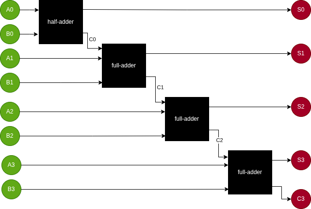
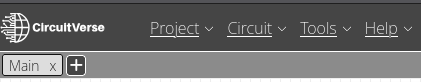
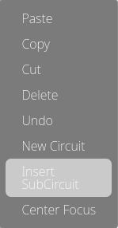
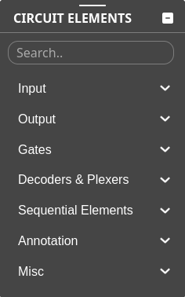
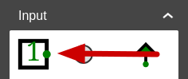
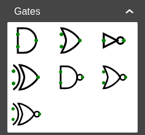

# Adder circuit

## Exercise

The goal of this exercise is to create a circuit that adds two 4-bit numbers.
Use [CircuitVerse Simulator](https://circuitverse.org/simulator) to complete
the exercise.

The steps required to complete the exercise are:

1. Create a half-adder circuit
2. Create a full-adder circuit
3. Combine your half-adder and full-adder sub-circuits to a 4-bit adder circuit
4. Verify your circuit is correct by manually comparing the output

Use the Wikipedia article on [Binary
Adders](https://en.wikipedia.org/wiki/Adder_(electronics)#Binary_adders) as
reference.

Here is how to combine the sub-circuits.

## CircuitVerse

CircuitVerse is a free, open-source platform which allows users to construct
digital logic circuits online.

To get started, simply go to [CircuitVerse](https://circuitverse.org/) website
and click the "Launch Simulator" button.

### Combining circuits

To add a new circuit, click the "+" button at the top.

You can insert a sub-circuit in another circuit by right-clicking on the canvas and select "Insert SubCircuit" from the menu.

### Circuit elements

Circuit elements can be added using the toolbox.

For this exercise you need to use the input, output and gates elements.

To form a circuit, connect the elements by drawing lines between the green
dots.

Click on an input to toggle between 1 and 0.
