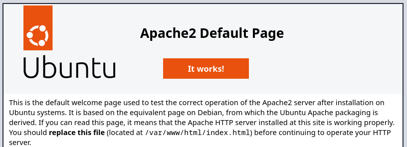
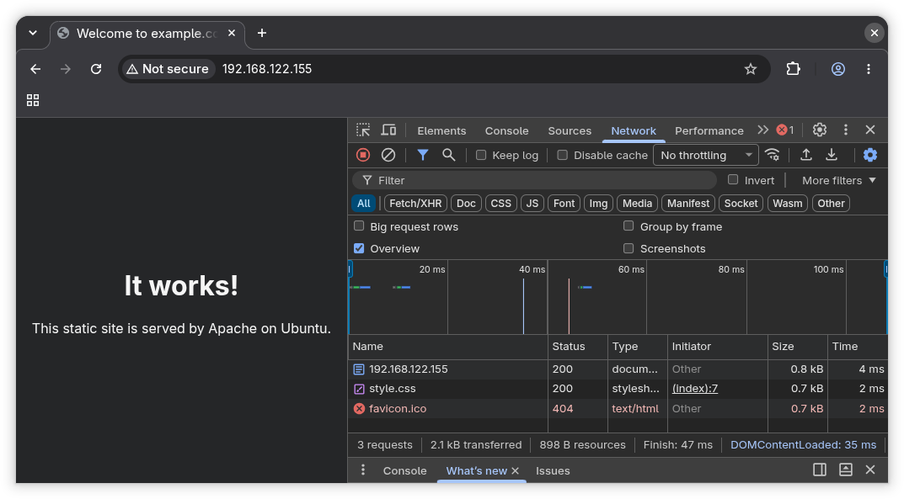
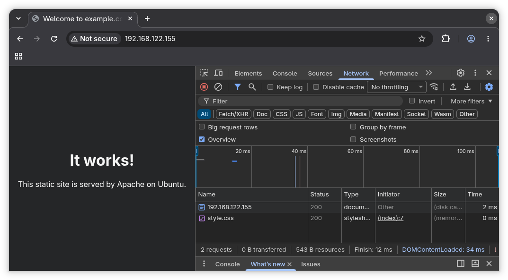

# Apache (web server)

## Background

This guide describes how to set up a static web page on Ubuntu using Apache.
Apache is popular web server.
It has been around since 1995 and is therefore stable in the world of website
hosting.

A static web page means that files are served over HTTP as is.
All users visiting the site, will see the exact same page.
This is in contrast to dynamic web page, in which content of the page will show
up differently based on user input.
Just like when you visit Facebook or YouTube, the content shown will be very
different from what your mom sees.

A static website is sufficient for a basic marketing website.
Though many real world marketing website use a content management system (CMS),
like Wordpress, to allow none technical people to change the content.

## What you will learn

Following this guide, you will learn the basics of:

- Updating and installing software
- Management of services
- Managing Apache virtual hosts
- Firewall rules on Ubuntu

## Prerequisite

You will need root access to a server running Ubuntu.
This guide has been tested with version 26.04, but should work with other
versions of Ubuntu as well.

You don't need a lot of server resources for this.
1 core and 2GiB RAM and 10GiB disk should be enough.

SSH access is recommended, but not strictly required.

## Install Apache

Start by making sure your server is up-to-date.

```sh
sudo apt update
sudo apt upgrade -y
```

The `sudo apt update` command will update the list of available packages.
Then `sudo apt upgrade -y` will install any upgrades to the current installed
packages.
The `-y` argument ensures the packages gets upgraded without further questions,
as `-y` means answer yes to all questions.

Apache is available under the package name `apache2`, so you can install it with the following command:

```sh
sudo apt install apache2 -y
```

Services on most Linux distributions are managed with the `systemctl` command.
A service is a process that is meant to run in the background without any
direct user interaction.
Services are commonly started automatically when the OS boots, or when required
by other software.
Apache runs as a service, since it is meant to be access through a web browser
rather than directly through the terminal.

You can verify that the `apache2` service is running with:

```sh
sudo systemctl status apache2
```

It should say `active (running)` in green, somewhere in the output.
Press `q` to exit the status view.

## Configure firewall

Ubuntu comes with a firewall called **ufw**, which stands for uncomplicated
firewall.
Many packages on Ubuntu, ships with firewall profiles.

You can see the profiles you have available with:

```sh
sudo ufw app list
```

There are 3 different profiles for Apache.

| Profile | Ports opened |
|---|---|
| `Apache` | 80 (HTTP) only |
| `Apache Secure` | 443 (HTTPS) only |
| `Apache Full` | 80 and 443 |

We want to allow `Apache Full` profile which allows both HTTP and HTTPS traffic
on the default ports.
Also, if you access the server over SSH, you must allow the "OpenSSH" profile,
otherwise you will lose access.

```sh
sudo ufw allow 'Apache Full'
sudo ufw allow 'OpenSSH'
```

Next, you need to make sure the firewall is enabled and got the profiles
loaded.
You can check if the firewall is enabled with:

```sh
sudo ufw status
```

On a fresh Ubuntu install it will say `Status: inactive`, meaning that the
firewall haven't been enabled yet.
To make sure the firewall is enabled, and the right rules are set, do:

```sh
sudo ufw enable
sudo ufw reload
```

Then check the status again with the command from above.
It should look like this:

```
To                         Action      From
--                         ------      ----
Apache Full                ALLOW       Anywhere
OpenSSH                    ALLOW       Anywhere
Apache Full (v6)           ALLOW       Anywhere (v6)
OpenSSH (v6)               ALLOW       Anywhere (v6)
```

You will see a duplicate of the rules with "v6" in the description.
It simply means that the rule/profile applies to IPv6 also.

Maybe you are wondering what happens to all traffic we haven't specified a rule
for?
The default is to allow outgoing connections and deny all incoming.
You can view the default rule by running:

```sh
sudo ufw status verbose
```

## Verify web server and firewall rules

It might be a good time to check that everything works so far.
Apache comes with a default web-page, let's try if we can access it.
You need to find the servers IP address.
This can be done in a couple of different ways.
One way that works across just about every Linux distributions, is with:

```sh
ip address
```

It shows both IPv4, IPv6 and MAC addresses for all network interfaces of the system.
There is a special loopback device (`lo`) with the IPv4 `127.0.0.1` or IPv6
`::1`, which redirects all traffic to the system itself.

The command `curl` is commonly used to make web request from the terminal.
We can use it to check that Apache works from the server itself.

```sh
curl -I http://127.0.0.1
```

If you see `HTTP/1.1 200 OK` it means that it is working.
The `-I` argument instructs `curl` to only print the headers of the response.
If you run the command again without `-I` then you will see the response body.

Systems typically have the host name `localhost` pointing to `127.0.0.1`, so
that should work as well.

```sh
curl -I http://localhost
```

Next, try to access the page from a web browser on your own computer.
Using the IP `127.0.0.1` won't work, since on your computer, it will loop back
to your own machine.

Let's try a different command to find the servers IP.
This command might no work on all Linux variants, but on Ubuntu, it likely
gives you just the IP you are interested in.

```sh
hostname -I
```

Open `http://YOUR_SERVER_IP` in a web browser, replacing `YOUR_SERVER_IP` with
the IP of your server.
You should see the default **Apache2 Ubuntu Default Page**.



By default, Apache serves files from `/var/www/html`.
If you `cat` the `index.html` file:

```sh
cat /var/www/html/index.html
```

You will see the same as if you made a request with `curl`:

```sh
curl http://localhost
```

## Create your own static site

### Create the directory

Create a directory for the site.
Static files will be served from `public_html` subdirectory.
In a real world set up you would replace `example.com` with the domain name of
your site.

```sh
sudo mkdir -p /var/www/example.com/public_html
```

### Set ownership and permissions

Give your user ownership so you can edit files without `sudo`, and make sure
Apache (which runs as `www-data`) can read them:

```sh
sudo chown -R $USER:$USER /var/www/example.com
sudo chmod -R 755 /var/www/example.com
```

`755` means the owner can read/write/execute, while everyone else (including
Apache) can read and traverse directories.

### Create an `index.html`

```sh
nano /var/www/example.com/public_html/index.html
```

Paste the following:

```html
<!DOCTYPE html>
<html lang="en">
<head>
  <meta charset="UTF-8">
  <meta name="viewport" content="width=device-width, initial-scale=1.0">
  <title>Welcome to example.com</title>
  <link rel="stylesheet" href="style.css">
</head>
<body>
  <main>
    <h1>It works!</h1>
    <p>This static site is served by Apache on Ubuntu.</p>
  </main>
</body>
</html>
```

Save and exit (`Ctrl+O`, `Enter`, `Ctrl+X`).

### Add a stylesheet (optional)

```sh
nano /var/www/example.com/public_html/style.css
```

```css
body {
  font-family: system-ui, sans-serif;
  background: #f5f7fa;
  color: #222;
  display: grid;
  place-items: center;
  min-height: 100vh;
  margin: 0;
}

main {
  text-align: center;
}
```

## Set up a Virtual Host for your site

### Create a Virtual Host configuration

A **virtual host** tells Apache which directory to serve for which domain name.
This lets one server host many sites.

Create a new configuration file:

```sh
sudo nano /etc/apache2/sites-available/example.com.conf
```

Add the following:

```apache
<VirtualHost *:80>
    DocumentRoot /var/www/example.com/public_html

    <Directory /var/www/example.com/public_html>
        Options -Indexes +FollowSymLinks
        AllowOverride None
        Require all granted
    </Directory>

    ErrorDocument 404 /404.html

    ErrorLog ${APACHE_LOG_DIR}/example.com-error.log
    CustomLog ${APACHE_LOG_DIR}/example.com-access.log combined
</VirtualHost>
```

Here are what the different parts of the configuration means.

| Directive | Purpose |
|---|---|
| `DocumentRoot` | The folder containing your site's files |
| `Options -Indexes` | Disables directory listings, so visitors can't browse folders that lack an `index.html` |
| `Options +FollowSymLinks` | Allows Apache to follow symbolic links |
| `AllowOverride None` | Ignores `.htaccess` files (faster and more secure for a static site) |
| `Require all granted` | Allows all visitors to access the directory |
| `ErrorDocument 404` | Serves your custom 404 page |
| `ErrorLog` / `CustomLog` | Per-site log files in `/var/log/apache2/` |

### Enable your site and disable the default one

```sh
sudo a2ensite example.com.conf
sudo a2dissite 000-default.conf
sudo systemctl reload apache2
```

`a2ensite` means "Apache2 enable site" and `a2dissite` means "Apache2 disable
site", where `000-default.conf` is the configuration file for the default site
that ships with Apache on Ubuntu.

> Disabling the default site is recommended so requests that don't match any
> `ServerName` don't fall through to the placeholder page. If you'd like to
> keep the default site as a catch-all, skip the second command (the
> first-loaded configuration file acts as the default).

### Test the configuration

#### Check for syntax errors

```sh
sudo apache2ctl configtest
```

You should see:

```
Syntax OK
```

If you see a warning like `Could not reliably determine the server's fully qualified domain name`, it's harmless, but you can fix it:

```sh
echo "ServerName localhost" | sudo tee /etc/apache2/conf-available/servername.conf
sudo a2enconf servername
```

#### Test in web browser

Open `http://YOUR_SERVER_IP` in a web browser, replacing `YOUR_SERVER_IP` with
the IP of your server.

### Note on domain names (optional)

Normally each Virtual Host will have its own domain name.
But it will be a bit excessive to buy a bunch of domains, just to follow along
this guide.
Therefore, we skipped the part on setting a domain name for the Virtual Host.
If interested, you can add the following at line 2 of `/etc/apache2/sites-available/example.com.conf` file:

```apache
    ServerName example.com
    ServerAlias www.example.com
```

| Directive | Purpose |
|---|---|
| `ServerName` | The primary domain this virtual host answers for |
| `ServerAlias` | Additional names (e.g., the `www` version) |

Reload Apache:

```sh
sudo systemctl reload apache2
```

Test with:

```sh
curl -H "Host: example.com" http://localhost
```

Apache will now resolve the site using `HOST` header of HTTP request.
Browsers will automatically set it to what was typed in the address bar.
Because we don't have an actual domain for the site, the settings should be
disabled again, by removing the `SeverName` and `ServerAlias` lines again from
the `/etc/apache2/sites-available/example.com.conf` file.
After removed, do another reload:

```sh
sudo systemctl reload apache2
```

## Hardening and Performance Tweaks

### Inspect the logs

Apache created log files for the site as specified in the Virtual Host configuration.

```apache
    ErrorLog ${APACHE_LOG_DIR}/example.com-error.log
    CustomLog ${APACHE_LOG_DIR}/example.com-access.log combined
```

Where `APACHE_LOG_DIR` is a variable referring to `/var/log/apache2` directory.

You can therefore inspect the logs using:

```sh
cat /var/log/apache2/example.com-access.log
cat /var/log/apache2/example.com-error.log
```

In a real world set up, one would have a system that monitors log files across
all servers, using AI to detect abnormalities, which could indicate an attack.

### Hide Apache version information

If you run:

```sh
curl -I http://localhost
```

You will see somewhere, it says `Server: Apache/2.4.66 (Ubuntu)`.
Attackers can use this information, to check if there are any known
vulnerabilities for that particular version of Apache, that can be exploited.
We can disable the version information as follows.

```sh
sudo nano /etc/apache2/conf-available/security.conf
```

Set these values:

```apache
ServerTokens Prod
ServerSignature Off
```

**Note:** any line beginning with `#` are not interpreted as part of the
configuration, they are only there for documentation.

Apply the change:

```sh
sudo systemctl reload apache2
```

Test with:

```sh
curl -I http://localhost
```

### Add security headers

Some common vulnerabilities in web applications can simply be mitigated by
setting additional headers, instructing the browser on how to behave.
It doesn't make much of a difference for this static website, but it might on
other sites.
It is therefore a good habit to always configure.

Enable the headers module:

```sh
sudo a2enmod headers
```

Open the configuration:

```sh
sudo nano /etc/apache2/sites-available/example.com.conf
```

Add the following inside your `<VirtualHost>` block.

```apache
Header always set X-Content-Type-Options "nosniff"
Header always set X-Frame-Options "SAMEORIGIN"
Header always set Referrer-Policy "strict-origin-when-cross-origin"
```

Apply the change:

```sh
sudo systemctl reload apache2
```

Test with:

```sh
curl -I http://localhost
```

Google the header names (`X-Content-Type-Options`, `X-Frame-Options` and
`Referrer-Policy`) or AI, see if you can understand what they do.

### Enable compression

Compression reduces bandwidth and speeds up page loads.
The `deflate` module is usually enabled by default; confirm with:

```sh
sudo a2enmod deflate
```

Open the configuration:

```sh
sudo nano /etc/apache2/sites-available/example.com.conf
```

Add the following inside your `<VirtualHost>` block.

```apache
<IfModule mod_deflate.c>
    AddOutputFilterByType DEFLATE text/html text/plain text/css
    AddOutputFilterByType DEFLATE application/javascript application/json image/svg+xml
</IfModule>
```

Check the configuration and apply the changes:

```sh
sudo apache2ctl configtest && sudo systemctl reload apache2
```

Test:

```sh
curl -I --compressed http://localhost
```

You should see `Content-Encoding: gzip`.
Also, take a look at the `Content-Length` header.
It is the number of bytes in the response and should be smaller than if ran the
command without `--compressed`.
Web browsers will automatically ask for compressed response if available.

### Enable browser caching

The best way to speed up the loading of your website, and reduce the load on
your server, would be if your browser could just show the page, without having
to make a request to the server.
This can easily be done by instructing the browser to cache the website.

```sh
sudo a2enmod expires
```

Open the configuration:

```sh
sudo nano /etc/apache2/sites-available/example.com.conf
```

Add the following inside your `<VirtualHost>` block.

```apache
<IfModule mod_expires.c>
    ExpiresActive On
    ExpiresByType text/html     "access plus 1 minute"
    ExpiresByType text/css      "access plus 1 week"
    ExpiresByType application/javascript "access plus 1 week"
    ExpiresByType image/jpeg    "access plus 1 month"
    ExpiresByType image/png     "access plus 1 month"
    ExpiresByType image/webp    "access plus 1 month"
    ExpiresByType image/svg+xml "access plus 1 month"
</IfModule>
```

Check the configuration and apply the changes:

```sh
sudo apache2ctl configtest && sudo systemctl reload apache2
```

To test, open `http://YOUR_SERVER_IP` in a web browser.
Hit <kbd>Ctrl</kbd>+<kbd>Shift</kbd>+<kbd>I</kbd> then click "Network" tab.
Now, reload the page.

Before:



After:



**Note:** you can specify how long before the cache expires per file type.

Using caching have a huge drawback.
It means that users will not see any changes to your site for as long as their
browser keeps the cached version.
Commonly, one would configure a low expiration for `text/html` files, then use
a new unique name for each new version of the other files.
That way, users see fresh content, without having to re-fetch all resources.

Caching is especially important for images, as it can save a lot of bandwidth
and make the site feel a lot faster to navigate.

## Enable HTTPS

HTTPS is the secure version of HTTP protocol, using encryption to secure the
connection (protect integrity and confidentiality).
This can be accomplished for free using the service [Let's
Encrypt](https://letsencrypt.org/).
However, it requires that you have a domain for the server and that it is
publicly available, which we don't have for this setup.
Therefore, the following is just to show how it can be configured.
You be able to set it up yourself, because of the aforementioned limitation of
our setup.

You should continue reading, but not running the commands.

### Install Certbot

```bash
sudo apt install certbot python3-certbot-apache -y
```

### Obtain and install a certificate

```bash
sudo certbot --apache -d example.com -d www.example.com
```

Certbot will:

1. Ask for an email address (for expiry notices)
2. Ask you to accept the terms of service
3. Verify you control the domain
4. Create an SSL virtual host (`example.com-le-ssl.conf`)
5. Offer to redirect all HTTP traffic to HTTPS. Choose the redirect option.

### Verify automatic renewal

Certificates last 90 days.
The Certbot package installs a systemd timer that renews them automatically.
Test it with a dry run:

```bash
sudo systemctl list-timers | grep certbot
sudo certbot renew --dry-run
```

### Confirm

Visit `https://example.com`.
You should see the padlock icon in your browser.
