# NextCloud hardening

There are a couple of things we can do on top of a basic NextCloud installation
to make it more secure.

## Brute-force prevention

### Background

A brute-force attack is where the attacker tries different passwords until they
are able to log in.
Naive approach is simple to exhaust all possible combinations.
But actual brute-force attacks exploit the fact that humans are bad at coming up with and remembering good passwords.
Different people also have a tendency to come up with the same passwords independently.
People compiles lists of commonly used passwords from previous leaks.
Just search the web for "top 100 passwords" and you will find such lists.

Another tacking for targeted attacks are to scrape a persons social media for
information, then use that to generate a tailored list of possible passwords.
E.g. name of signification other plus year-of-birth.
Or first letter of the name of closest family members plus the numbers "1234".
For a while, many sites have required a special-symbol as part of the password.
Many people just add an "!" at the end of their password to fulfill that requirement.

Related to brute-force is credential-stuffing.
Those are not the same.
Credential-stuffing exploits the fact that people tend to reuse password for multiple services.
So if a leak occurs on one service, attackers will attempt to log in to other
services for which people commonly hold accounts.

A good password needs to be long and random, just like a good night out.
And don't reuse your passwords.
I recommend using an end-to-end encrypted password manager.

### Brute-force prevention in NextCloud

NextCloud already ships with brute-force prevention.
You can test it by continuously attempting login with a wrong password.

After attempting login with "a" as password 10 times, I got this:

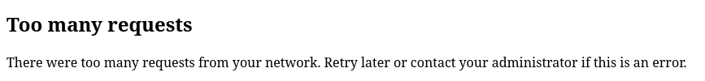

To do a brute-force reset, you first need to know your IP.
Since our servers are in a VPN, you can find the IP in your VPN client (WireGuard).
Next, you need a console/terminal on your NextCloud server.
Then use the command:

```sh
sudo -u www-data php /var/www/nextcloud/occ security:bruteforce:reset <your-ip>
```

`sudo -u www-data` runs the rest of the command as `www-data` user, same as
Apache runs as.
`/var/www/nextcloud/occ` is the path for a PHP script, which we can execute
with the PHP command.
`security:bruteforce:reset` is an argument to the script, instructing it what to do.

After running the command you should be able to log in again.

You can read more about [NextCloud Brute-force
prevention](https://docs.nextcloud.com/server/stable/admin_manual/configuration_server/bruteforce_configuration.html)
in the official documentation.

The documentation [recommends using fail2ban](https://docs.nextcloud.com/server/stable/admin_manual/configuration_server/bruteforce_configuration.html#brute-force-protection-vs-fail2ban) in addition to the build in brute-force protection.
As long as NextCloud is only accessible from a VPN, I don't think it is necessary to setup fail2ban.
They have [setup instructions for
fail2ban](https://docs.nextcloud.com/server/stable/admin_manual/installation/harden_server.html#setup-fail2ban), in case you are interested.

### Restrict admin to specific IPs

NextCloud can restrict access to admin functionality outside specific range of
IP addresses.

Admin user without restrictions has access to "Administration settings".
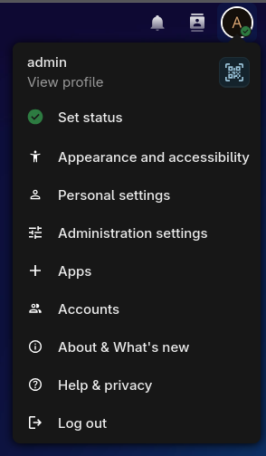

Open your NextCloud config in an editor.
Ether `sudoedit /var/www/nextcloud/config/config.php` or `sudo nano
/var/www/nextcloud/config/config.php`.
Between the lines:

```php
$CONFIG = array (
```

And:

```php
);
```

Add the following:

```php
  'allowed_admin_ranges' => [
    '192.168.3.x/32'
  ],
```

Replace `'192.168.3.x/32'` with the IP/subnet from your VPN client (WireGuard).
Save the file.

Log in to NextCloud again, and nothing looks different, because you are only
allowing your own IP.

When making config changes to improve security, it is important to verify the
settings works as intended.
To verify this setting, open the `config.php` again temporary change me IP to
something else.
Now, log in to NextCloud again.
It should look like this:

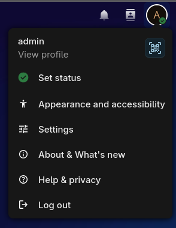

Go back to the config and change it back to your IP addresses.

In the real world you would set `allowed_admin_ranges` to the IPs of your office location.
Or if using network segmentation, you could have an administration network
segment, from which all administration tasks is performed.

The official for `allowed_admin_ranges` is found
[here](https://docs.nextcloud.com/server/stable/admin_manual/installation/harden_server.html#restrict-admin-actions-to-a-specific-range-of-ip-addresses).

## Antivirus scanner

With everything where users can upload files, malware becomes a problem.
NextCloud can be extended with apps, and you can use "Antivirus app for Files"
to automatically scan newly upload files with the open source antivirus engine
[ClamAV](https://en.wikipedia.org/wiki/ClamAV).

Install ClamAV:

```bash
sudo apt install clamav clamav-daemon
```

Installing the packages creates a couple of services.
`clamav-daemon` can scan files using multiple threats for performance.
`clamav-freshclam` updates the local database of known virus signatures.

The default configuration will check for new database updates 24 times a day.
You can run `cat /etc/clamav/freshclam.conf` to inspect with config.

Make sure the `clamav-daemon` is started.

```bash
sudo systemctl enable clamav-daemon
sudo systemctl start clamav-daemon
```

Btw, [daemon](https://en.wikipedia.org/wiki/Daemon_(computing)) is old-school
UNIX terminology for a background process.
What we call an operating system service nowadays.

The Antivirus app needs to be added to NextCloud.
When you try to add apps:

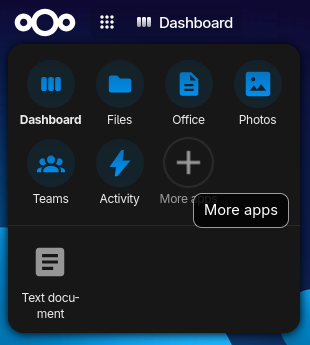

You get an error.

This is because there is a limit on how much memory a PHP script is allowed to
use.
We need to increase this limit before we can use apps.

To verify the issue, go to Administration settings -> Overview.

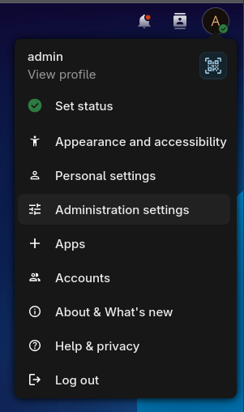

This is the warning we will attempt to get rid of:

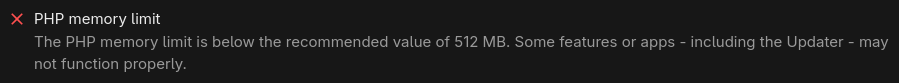

Run the command:

```bash
sudo nano /etc/php/8.5/apache2/php.ini
```

*Assuming PHP 8.5 is still the current version of PHP when you read this.*

Find the `memory_limit` line, and change it to:

```ini
memory_limit = 512M
```

Save the file and restart Apache.

```bash
sudo systemctl restart apache2
```

Verify that the "PHP memory limit" warning has disappeared from NextCloud ->
Administration settings -> Overview.

You can now add apps.


Find the "Antivirus for Files" app and click download and enable icon.

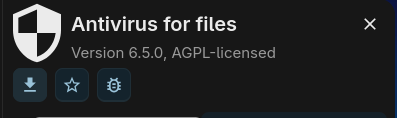

Next, go to Administration settings -> Security -> Antivirus for files.
And change the settings as shown.

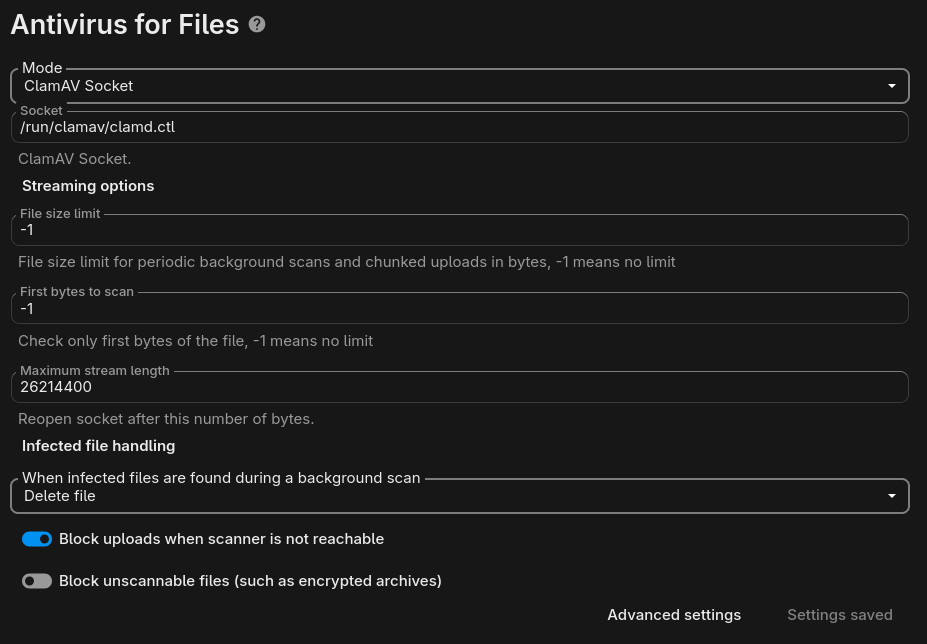

Remember to hit "Save".

To verify that it works, I guess we need to download a virus.
Feel free to skip this step, if you feel like it is crossing a line.
For testing, we could use the classic [ILOVEYOU
virus](https://en.wikipedia.org/wiki/ILOVEYOU) from the year 2000, which you can get from <https://www.cexx.org/loveletter.htm>.
Copy the source code from the cexx site.
Go to NextCloud under Files, select "Text document".

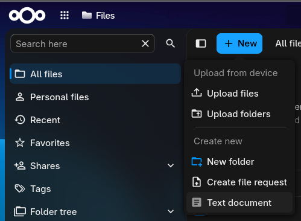

Give it a name and select "Blank" as template.
Paste the source code for the virus.

It will prevent you from saving the file.
You should see that the file size is 0.

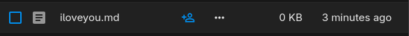

If you go to Administration settings -> Logging, you will see that it detected
the virus.

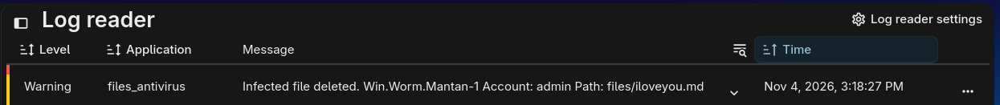

The official for adding antivirus scanner is found
[here](https://docs.nextcloud.com/server/stable/admin_manual/configuration_server/antivirus_configuration.html).
