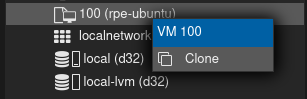
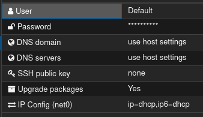

# Klon Ubuntu Server

## Baggrund

Proxmox gør det nemt at oprette nye virtuelle maskiner, hvilket er godt til at
eksperimentere med forskellige ting.
Men bliver hurtigt træls at skulle installere Ubuntu Server forfra, hver gang
man vil prøve noget nyt.
Proxmox har heldigvis en funktion hvor man kan konvertere en færdig
konfigureret VM til en template.
Man kan derefter oprette nye VM'er ud fra en template, hvilket resultere kloner
som er 100% identisk.

## Installer Ubuntu Server

Hvis ikke du har en VM allerede at lave en klon af, så følg [Opret virtuel
maskine (VM)](./proxmox-create-vm.md) og [Installer Ubuntu
Server](./install-ubuntu-server.md).

Hvis allerede har en VM du vil bruge som template, skal du sikrer dig at den er startet.
Derefter dobbelt klik på navnet på din VM under "Server View" i venstre side af
Proxmox interfacet.

Du burde nu have et vindue med en console/terminal hvori du kan skrive kommandoer.

## Klargør VM

Inden du laver din VM om til en template skal der laves lidt klargørring.
Det er for at gøre det nemmere at konfigurer de kloner som laves.
Eftersom en klon er en identisk kopi, giver det problemer hvis klonen også får
samme IP.
Yderligere vil man ofte også give hver klon sit eget hostname og evt. SSH
nøgler (mere om det senere).

Åben en console/terminal på den VM du vil bruge som base.
Login, hvis du ikke allerede er det.

Vi bør sikre os at alt er fuldt opdateret inden vi laver en template.
Disse kommandoer bør også være det første du gør i hver klon.

```sh
sudo apt update
sudo apt upgrade -y
```

Dertil skal vi installere et par værktøjer.

```sh
sudo apt install -y cloud-init qemu-guest-agent
sudo systemctl enable qemu-guest-agent
```

`cloud-init` gør det muligt at konfigurer IP, hostname og SSH nøgler fra Proxmox.
Og `qemu-guest-agent` er påkrævet for at udveksle information mellem Proxmox
og VM.

```sh
sudo truncate -s 0 /etc/machine-id
sudo rm -f /var/lib/dbus/machine-id
```

```sh
sudo apt clean
sudo cloud-init clean --logs
sudo poweroff
```

I Proxmox interfacet:

1. Vælg din VM
2. Åben "Hardware"
3. Klik "Add" -> "CloudInit Drive"
4. Vælg "local-lvm" under "Storage", klik "Add"
5. Under "Options", dobbelt-klik "QEMU Guest Agent" og slå "Use QEMU Guest
   Agent" til, derefter "OK"
6. Under "Cloud-Init", vælg "IP Config" og slå DHCP til for både IPv4 og IPv6.
7. Klik "Regenerate Image"
8. Under "More" (i toppen), vælg "Convert to template"

Nu er din VM blevet til en template.
Du kan ikke starte en template direkt, men du kan lave en klon ved at højre-klikke på navnet (venstre side) og vælge "Clone".



Indtast `<brugernavn>-clone` i Name feltet.
Altså, hvor `<brugernavn>` er udskiftet med dit brugernavn.
Derefter klik "Clone".
Klik på din nye klon (venstre side) og vælg "Cloud-Init".



Herfra den du ændre forskellige indstillinger for din klon.
Du bør nok sætte et nyt password.
Når du har lavet ændringer skal du klikke "Regenerate Image".

Din klon er nu klar til at blive startet.

Herfra er du i stand til at lave yderlige kloner på blot få sekunder.
