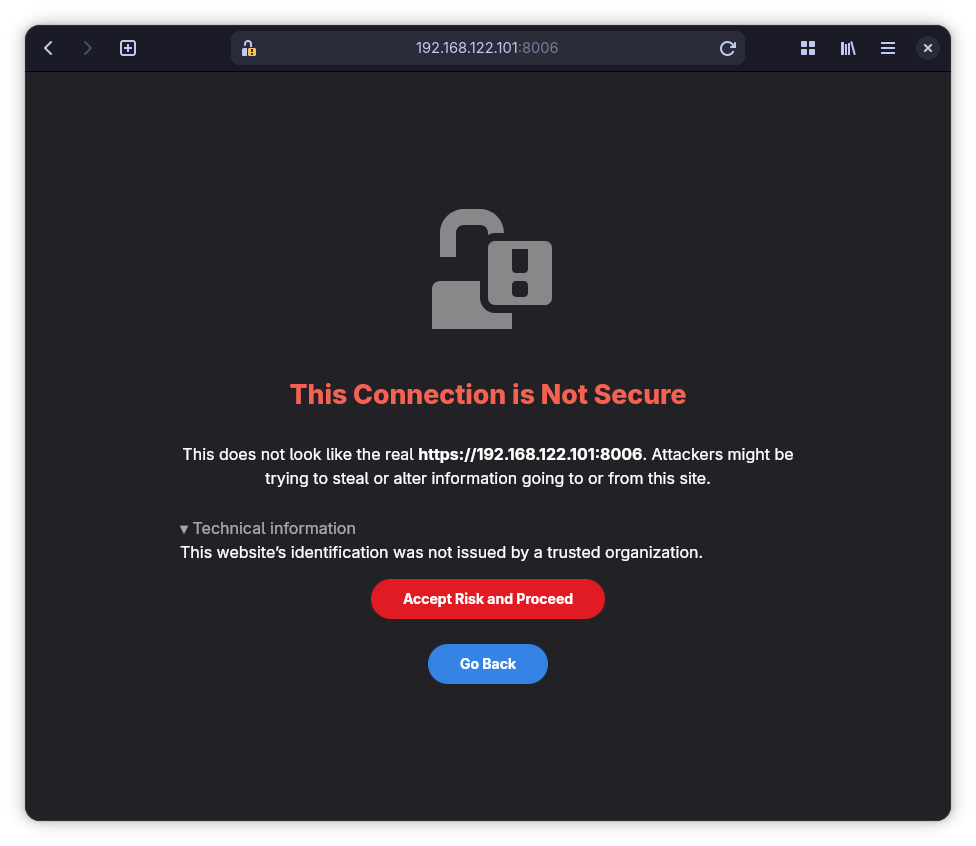
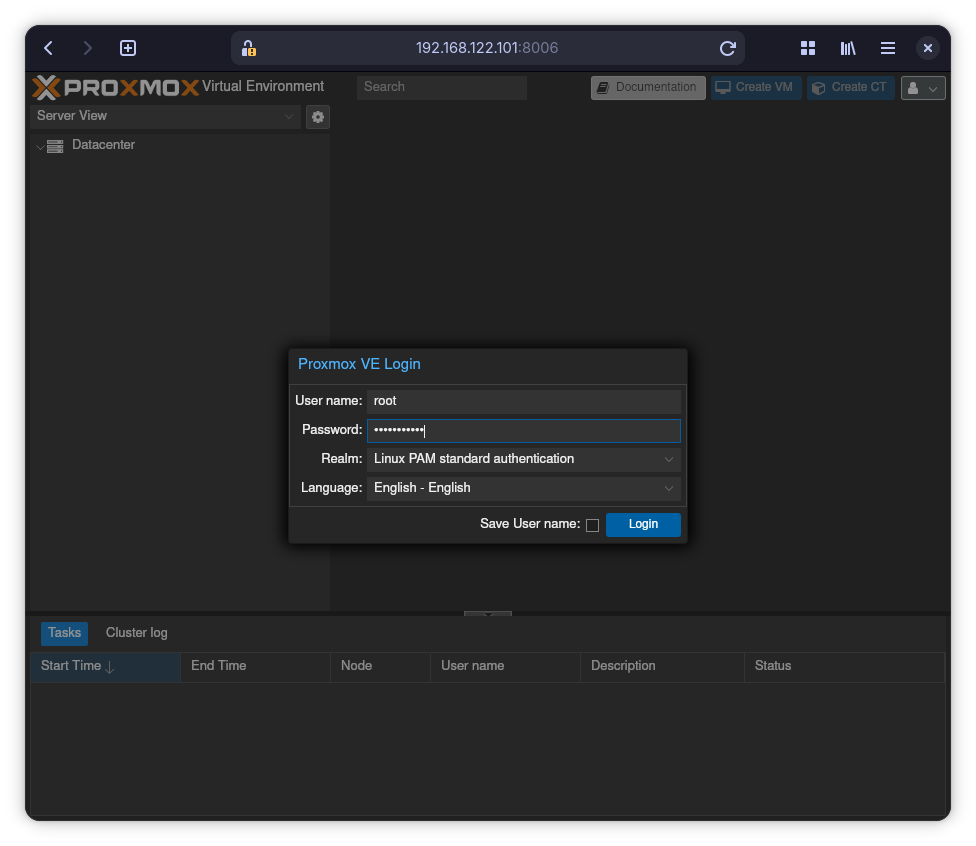
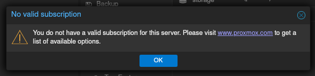

# Proxmox login

Skriv IP adressen på Proxmox serveren efterfulgt af ":8006" i adresse feltet i
en web browser.
F.eks. har Proxmox serveren IP 192.168.122.101, skal der stå
<https://192.168.122.101:8006> i adresse feltet.

Du vil få en advarsel om at forbindelsen ikke er sikkert.
Accepter risikoen og fortsæt.

> [!TIP]
> Skærm billedet kan se anderledes ud afhængig af din browser.

Advarslen betyder bare at jeg ikke har betalt en certifikatmyndighed for at
signere et certifikat til serveren.
Den er ikke på internettet, kun tilgængelig fra vores eget netværk.
Derfor ikke så vigtig.

> [!CAUTION]
> Hvis du ser sådan en advarsel når du prøver at besøge en hjemmeside på
> internettet, bør du være meget påpasselig.

## Login

Derefter login.

> [!TIP]
> Hvis dette er en frisk installation kan du bruge "root" som brugernavn og det
> password som blev skrevet under installationen.

Du behøver ikke en subscription.
Bare klik "OK".

