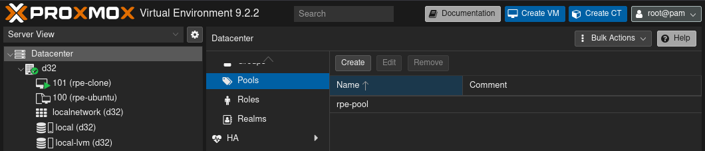
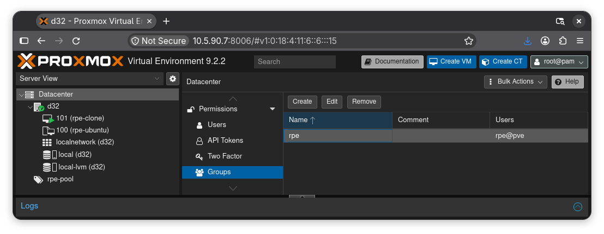
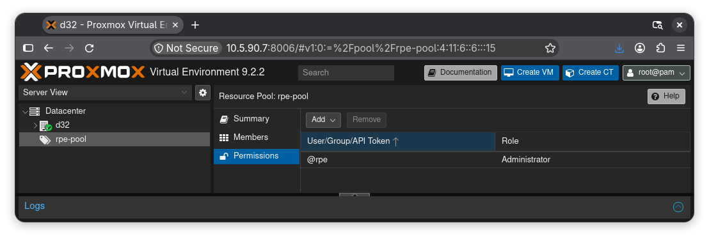
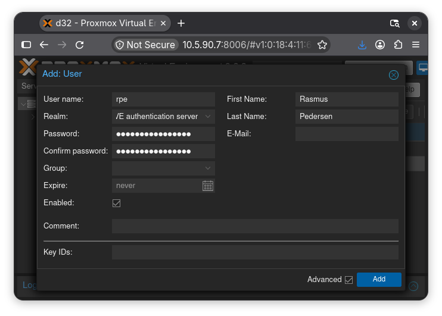

# Proxmox - Resource Pool

It is a bad idea to have several people share the same user account.
Therefore, after installing Proxmox, you should create your own user account.

In this guide, we will start by creating a resource pool.
Resource pools in Proxmox allows us to have isolated areas for a set of virtual
machines.
If each person using a Proxmox server, work in their own resource pool, then
they can freely create virtual machines without stepping on others toes.
Simply, you won't even see other peoples VMs.

## Create a pool

Go to datacenter (left panel).
Find pools and create a new pool.
Name it using your username follow by "-pool".

Example: my username is "rpe", so I should call my pool "rpe-pool".

## Create a group

Next, scroll to the group section.

Create a new group.
Use your username as the group name.

## Pool permissions

Next, select your pool (left panel).
Click "Add" -> "Group permission".
Then select your group and set role to "Administrator".

## Additional permissions

Go back to "datacenter" (left panel).
Select "permissions".
Now, create group permissions as shown.
Of course, use your group instead of "@rpe".

## Create user account

Finally, we need to create a user account.

- Under "Datacenter" -> "Permissions" -> "Users", click "Add".
- Type your username in the "User Name" field.
- Select "Proxmox VE authentication server" in "Realm" field.
- Fill out the password fields with a secure password that you can remember.
- Fill out your name and email.
- At the end, click "Add".

## Login

You should now be able to login with your new user.
Try it out!
